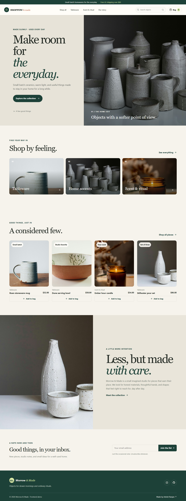

# Morrow & Made

A calm, editorial storefront concept for small-batch ceramics, candles, and everyday homewares. This project is a frontend-only demonstration; catalog, cart, checkout, and order confirmation run in the current browser session and reset when the page is refreshed.

**Live demo:** https://a2rp.github.io/ecommerce-storefront/

## Explore

- **Home** - browse collections, discover featured pieces, read the studio story, and try the newsletter form.
- **Shop** - search the catalog, filter by collection, sort by price or name, and view empty results.
- **Product details** - inspect materials and dimensions, choose a quantity, and add items to the bag.
- **Bag** - change quantities, remove pieces with confirmation, clear the bag with confirmation, apply `MORROW10`, and review shipping and estimated tax.
- **Checkout** - validate sample contact and address details and create a local sample order. No payment is processed and no details are sent to a server.
- **Order confirmation** - review the sample order reference and item summary.
- **Not found** - recover to the home page or shop from an invalid route.

The bag uses React state only. It does not use Local Storage, Context API, or a backend. Prices, stock, coupon rules, shipping, and estimated tax are sample values.

## Screenshots

### Pages

| Page | Preview |
| --- | --- |
| Home |  |
| Shop | 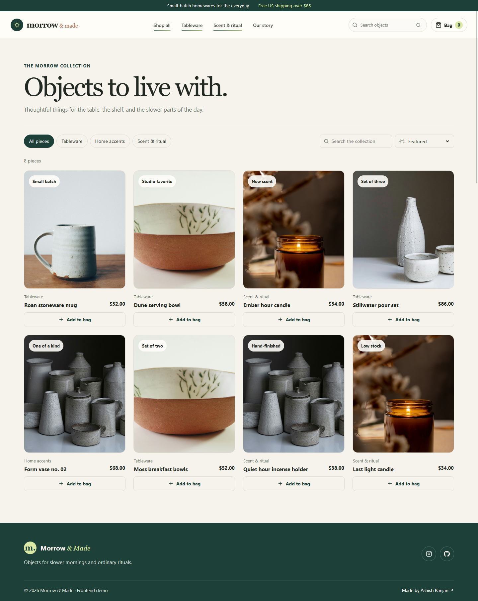 |
| Product details | 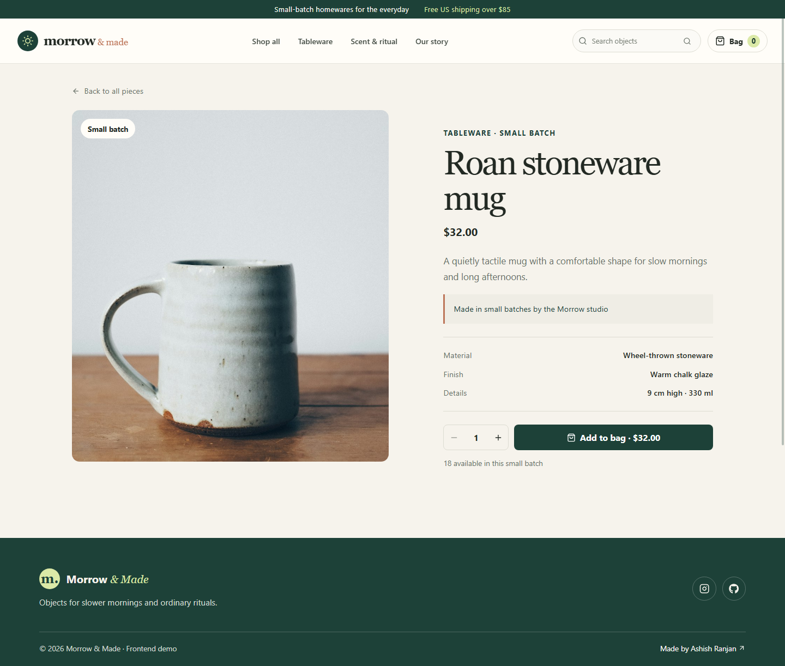 |
| Bag | 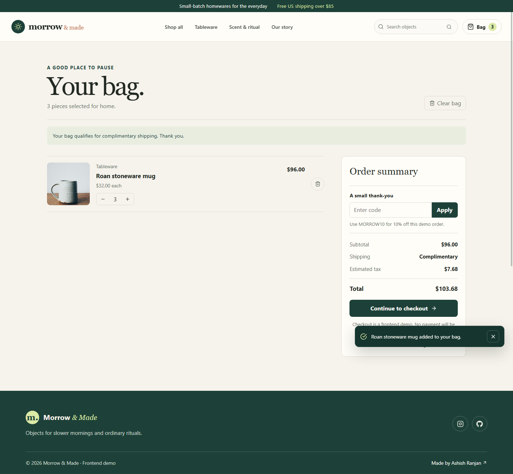 |
| Checkout | 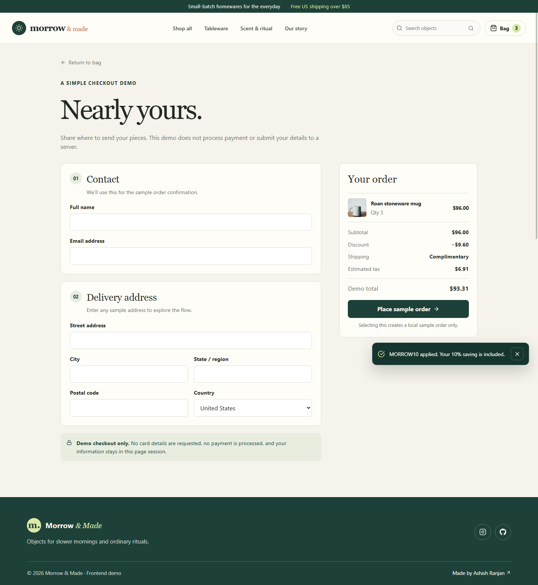 |
| Checkout validation | 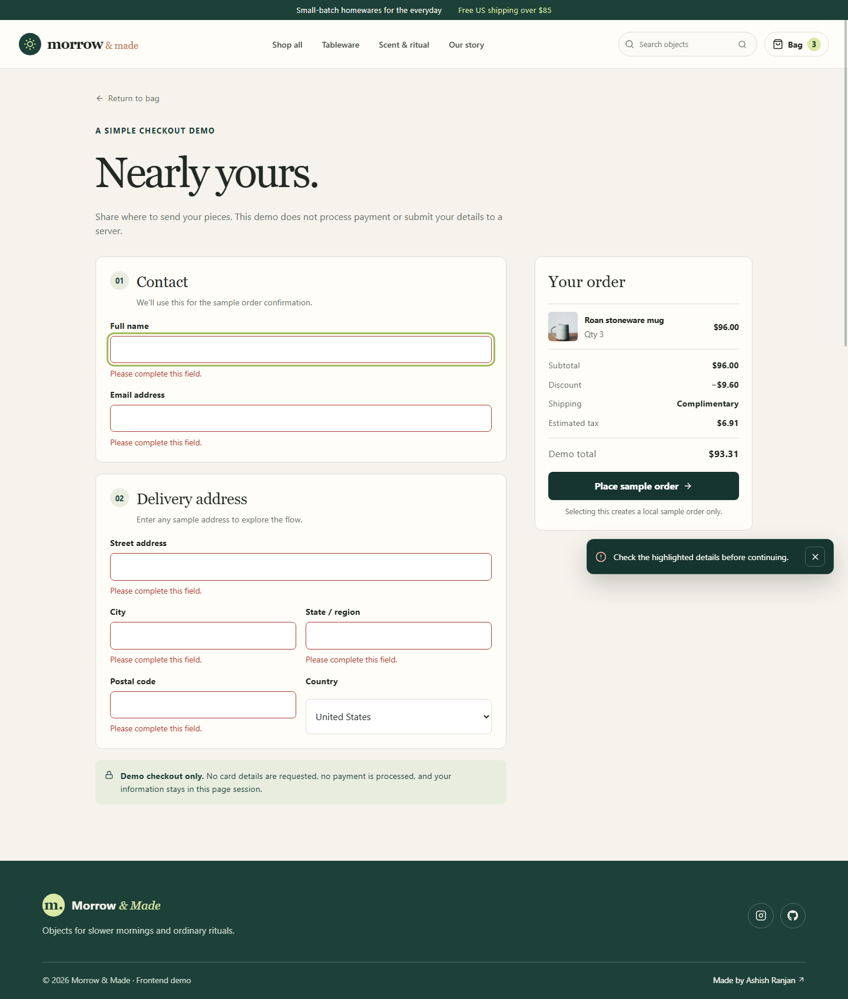 |
| Order complete | 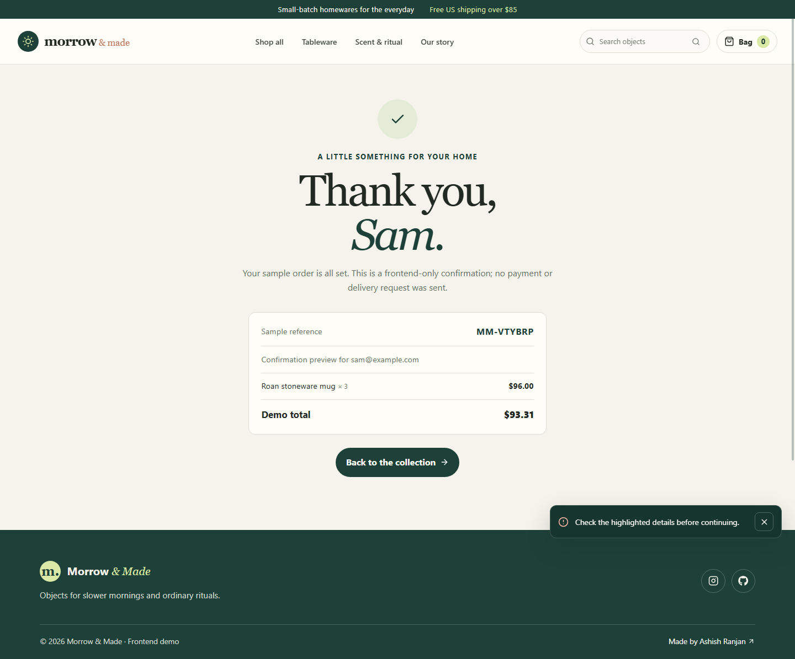 |
| Not found | 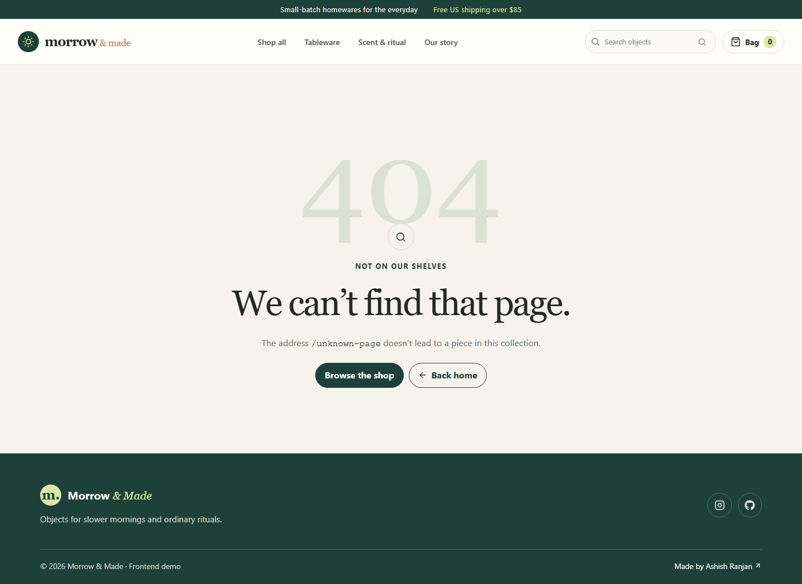 |
| Shop on mobile | 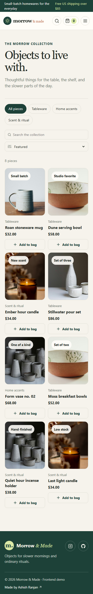 |

### Confirmation dialogs

| Action | Preview |
| --- | --- |
| Remove a piece | 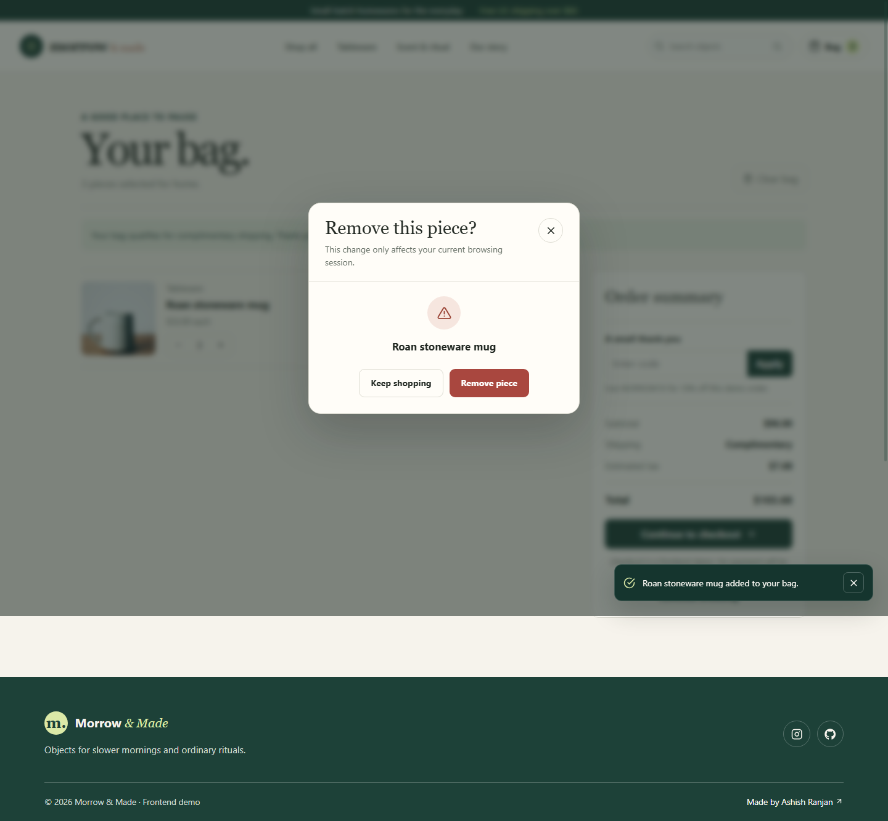 |
| Clear the bag | 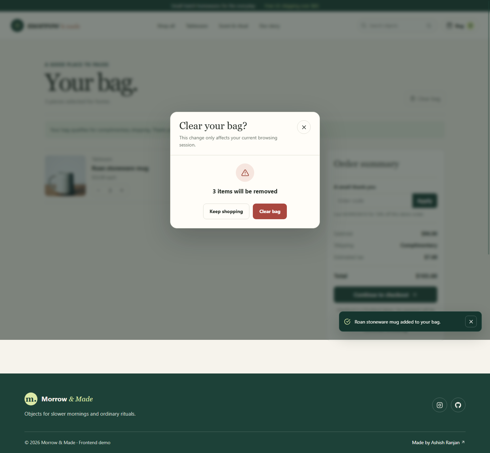 |

## Run locally

```bash
npm install
npm run dev
```

## Quality checks and deployment

```bash
npm run lint
npm run build
npm run deploy
```

The deploy script builds the app, copies `index.html` to the GitHub Pages `404.html` fallback, and publishes `dist` to the `gh-pages` branch.

## Image credits

Product photography is from Unsplash: [ceramic vessels](https://unsplash.com/photos/assorted-color-clay-pots-5HRCkrSs9Dk), [stoneware mug](https://unsplash.com/s/photos/ceramic-mug), [amber candle](https://unsplash.com/photos/a-lit-candle-sitting-on-top-of-a-table-CUoyo6Pz0pU), [ceramic pour set](https://unsplash.com/photos/two-white-ceramic-bowls-and-bottle-on-white-table-NLcLjLNUJbY), and [hand-painted bowl](https://unsplash.com/photos/empty-bowl-BgIOYG835og).

## Future improvements

A backend could connect a live catalog and inventory, customer accounts, persistent carts, payment processing, order management, and delivery updates.

## Links

- Portfolio: [https://www.ashishranjan.net](https://www.ashishranjan.net)
- GitHub: [https://github.com/a2rp](https://github.com/a2rp)
- CodePen: [https://codepen.io/ash1198](https://codepen.io/ash1198)
- LinkedIn: [https://www.linkedin.com/in/aashishranjan](https://www.linkedin.com/in/aashishranjan)
- Facebook: [https://www.facebook.com/theash.ashish/](https://www.facebook.com/theash.ashish/)
- YouTube: [https://www.youtube.com/@ashishranjan-ashz?sub_confirmation=1](https://www.youtube.com/@ashishranjan-ashz?sub_confirmation=1)
- Email: [mailto:ash.ranjan09@gmail.com](mailto:ash.ranjan09@gmail.com)

## Support

- Support: [https://a2rp-donation-page.netlify.app/](https://a2rp-donation-page.netlify.app/)
- Buy Me a Coffee: [https://www.buymeacoffee.com/a2rp](https://www.buymeacoffee.com/a2rp)
